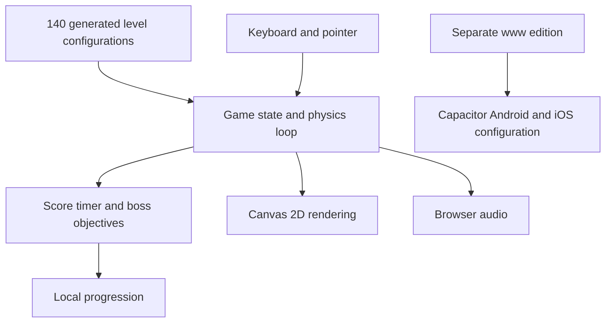

# Cosmo Citrouille — L'aventure des 140 mondes · Studio Niko Design

**Procedural 2D arcade game · Local progression · Capacitor project**

[Guide français](README_FR.md) · [Licence](LICENSE.md) · [English overview](#english-overview)

## Architecture réelle



| Source | Fonction constatée |
| --- | --- |
| [index.html](index.html) | Édition autonome, Canvas, boucle d'animation, contrôles et progression |
| [www/game.js](www/game.js) | Moteur de l'édition web destinée à Capacitor |
| [tests/smoke_800_points.cjs](tests/smoke_800_points.cjs) | Contrôles de logique de jeu dans un environnement simulé |
| [package.json](package.json) | Version 3.1.0, scripts et Capacitor 7 |

Le tableau LEVELS génère 140 configurations à partir de 14 secteurs, avec un boss tous les dix mondes. Les paramètres de vitesse et fréquence d'apparition évoluent selon le secteur et le niveau. Chaque niveau remet le score à zéro et exige 800 points ; les boss exigent également leur défaite. Le chrono utilise le temps de simulation avec delta borné à 45 ms par frame : 120 secondes de jeu ne garantissent pas 120 secondes murales lors d'un ralentissement ou passage en arrière-plan.

Jeu spatial d'Halloween en français pour les enfants à partir d'environ 7 ans.

**Contenu :** 140 mondes répartis dans 14 galaxies, 14 boss, modes Aventure et Défi, commandes tactiles et clavier, progression sauvegardée localement, aucun achat intégré ni publicité.

**Éditeur du projet :** [Nikoju1977](https://github.com/Nikoju1977). La présentation publique du jeu utilise le nom Cosmo Citrouille.

## Jouer dans le navigateur

Ouvrir [`index.html`](index.html) (version autonome) ou utiliser GitHub Pages pour une page jouable directement dans le navigateur.

**Activer GitHub Pages (une seule fois) :** dans le dépôt GitHub, ouvrir **Settings → Pages → Build and deployment**, puis choisir **GitHub Actions** comme source. La publication est automatisée par [`.github/workflows/deploy-pages.yml`](.github/workflows/deploy-pages.yml). Si le workflow a échoué avant l'activation, le relancer depuis **Actions → Publier Cosmo Citrouille sur GitHub Pages → Run workflow**. Une fois le déploiement réussi, l'adresse attendue est `https://nikoju1977.github.io/Cosmo-citrouille/` ; elle n'est accessible qu'après confirmation par GitHub.

## Projet web et applications mobiles

- `index.html` : jeu autonome, compatible avec une publication à la racine de GitHub Pages.
- `www/` : version PWA (avec manifeste, service worker, JavaScript et CSS externes).
- `JOUER_IMMEDIATEMENT.html` : copie autonome pour tester sans serveur.
- `capacitor.config.json` et `package.json` : projet Capacitor pour Android/iOS.
- `tests/` : tests d'interactions et de progression.

### Installer les dépendances et préparer les applications

```bash
npm install
npx cap add android
npx cap sync android
npx cap open android
```

Sur macOS avec Xcode, pour iOS :

```bash
npm install
npx cap add ios
npx cap sync ios
npx cap open ios
```

Les binaires natifs `APK` et `IPA` ne sont pas fournis ; compilation, signature et tests sur appareils physiques restent nécessaires avant publication.

Consultez [`README_FR.md`](README_FR.md) pour la liste des galaxies, les règles du jeu et les notes de compatibilité.

## Données personnelles

La progression est stockée localement dans le navigateur (`localStorage`). Le jeu ne contient pas de publicité ni de collecte de données intégrée.

## Droits

[Notice de droits](LICENSE.md) : droits réservés pour les contributions originales concernées ; droits tiers préservés.
## Défi 800 points / 2 minutes

Chaque monde doit être réussi avec **au moins 800 points en 120 secondes de simulation maximum**. Le compteur repart à zéro à chaque nouvelle planète. Contre les 14 boss, les 800 points **et** la victoire sur le boss sont nécessaires avant la fin du chrono. Les deux modes de difficulté disposent du même chrono ; les obstacles sont plus difficiles en mode Défi.

## Vérifier avant publication (version 3.1)

Exécuter `npm test` pour contrôler les 140 mondes, les 14 boss, le chronomètre de 120 secondes, l'objectif de 800 points et la remise à zéro du score. Le workflow `.github/workflows/deploy-pages.yml` lance ces contrôles avant le déploiement. La vérification automatisée n'équivaut pas à une validation sur appareils iOS et Android physiques.


## Qualification proposée

Comparer les 140 configurations et les 14 boss dans les éditions autonome et www. Vérifier victoire à 800 points, refus de victoire sans boss vaincu, expiration, remise à zéro, pause, reprise, sauvegarde et comportement lors de longues frames. Les tests existants ne prouvent pas la parité des éditions ni un rendu réel sur iPhone/Android. La configuration Capacitor ne fournit pas de binaire signé. Les droits des contenus tiers doivent être respectés. Aucun nouveau test, build natif ou déploiement exécuté.

## English overview

Cosmo Citrouille is a Canvas-based arcade game with 140 generated level configurations across 14 galaxies, 14 bosses, local progression and two difficulty modes. Each level requires 800 points within 120 seconds of simulation time, with boss defeat where applicable. The browser and Capacitor web editions must be checked separately. No signed APK or IPA, new device test or deployment is claimed.

[Notice de droits](LICENSE.md) : droits réservés pour les contributions originales concernées.
